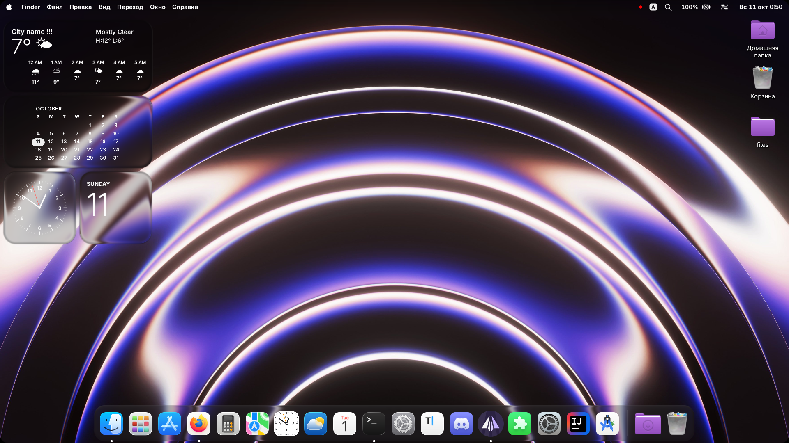
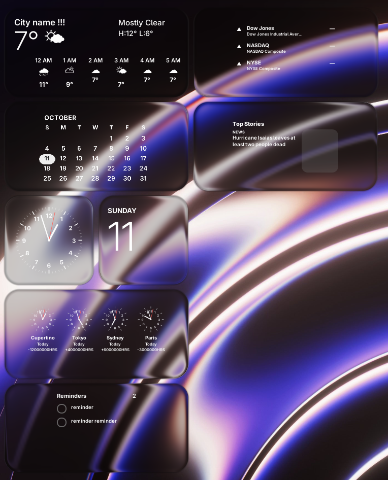
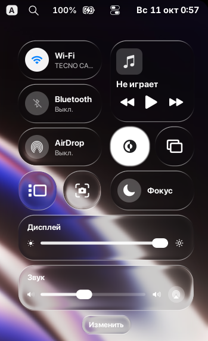

# GNOME-Tahoe
A macOS Tahoe-inspired GNOME desktop customization setup.

GNOME-Tahoe brings a Tahoe-inspired look to the GNOME desktop through customized extensions, blur effects, glass-like UI elements, widgets, icons, and wallpapers.

The project includes an installation script and a visual configuration guide to help users reproduce the intended appearance.

## Screenshots

<p align="center">
  
</p>

<p align="center">
  
  
</p>

## Features

- macOS Tahoe-inspired desktop appearance
- Blur and glass-like visual effects
- Customized GNOME Shell extensions
- Dock and menu customization
- Widgets and lock screen clock customization
- Top bar and Quick Settings customization
- Custom topbar icons and wallpapers
- Screenshot-based configuration instructions

## Requirements

- Linux with GNOME Shell 50.x
- Bash
- Git

Some extensions may require additional dependencies or specific GNOME Shell versions.

## Installation

Clone the repository:

```bash
git clone https://github.com/micronixxx/GNOME-Tahoe.git
cd GNOME-Tahoe
```

Run the installation script:

```bash
chmod +x install.sh
./install.sh
```

After installation, configure the extensions manually using the recommended settings shown in the screenshots.

## Extension Configuration

Recommended settings for all included extensions are documented through screenshots in the `docs/screenshots/` directory.

**It is recommended to apply the settings shown in the corresponding screenshots** to achieve the intended GNOME-Tahoe appearance.

Each screenshot is named after its respective extension UUID. Open the relevant image to view its recommended configuration.

The screenshots are organized separately from this README to keep the documentation concise and easy to navigate.

## Included Extensions

The project includes the following GNOME Shell extensions:

- Blur my Shell
- Cupertino Dock Lite
- Custom Command Toggle
- Dash2Dock Motion
- Display Brightness DDCutil
- Global Menu
- GTK4 Desktop Icons NG
- GTK Theme Sync
- Just Perfection
- Kiwi (is not Apple) (modded)
- Kiwi Menu
- Liquid Glass
- OSD Volume Number
- Quick Settings Scroll
- Rounded Corners
- Run Command
- Spotlight
- Tahoe Widgets (by murasame and me)
- Top Bar Organizer
- Transparent Window Moving
- User Themes
- Volume Percentage in Quick Settings
- Wack Lockscreen Clock
- Wi-Fi Hotspot Quick Settings
- Wiggly

## Wallpapers and Icons

GNOME-Tahoe includes custom wallpapers and icons used by the desktop setup. The installation script copies these assets to their respective user directories.

## Compatibility

GNOME-Tahoe is intended for GNOME-based Linux distributions. Compatibility depends on the GNOME Shell version and the versions of the included extensions.

Some extensions may require manual configuration or additional dependencies.

## Credits

GNOME-Tahoe includes and builds upon extensions and other work created by their respective authors.

Original copyright notices, attribution requirements, and license terms for third-party components must be preserved.

## License

GNOME-Tahoe is licensed under the GNU General Public License v3.0 (GPL-3.0), except where otherwise specified.

Third-party extensions and assets may be distributed under their own licenses. Refer to their original repositories and license files for details.

Repository: https://github.com/ьicronixxx/GNOME-Tahoe
